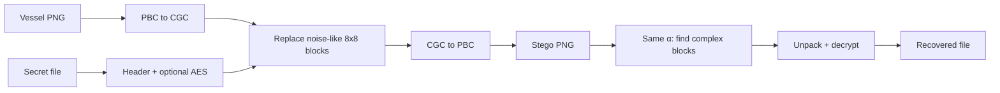
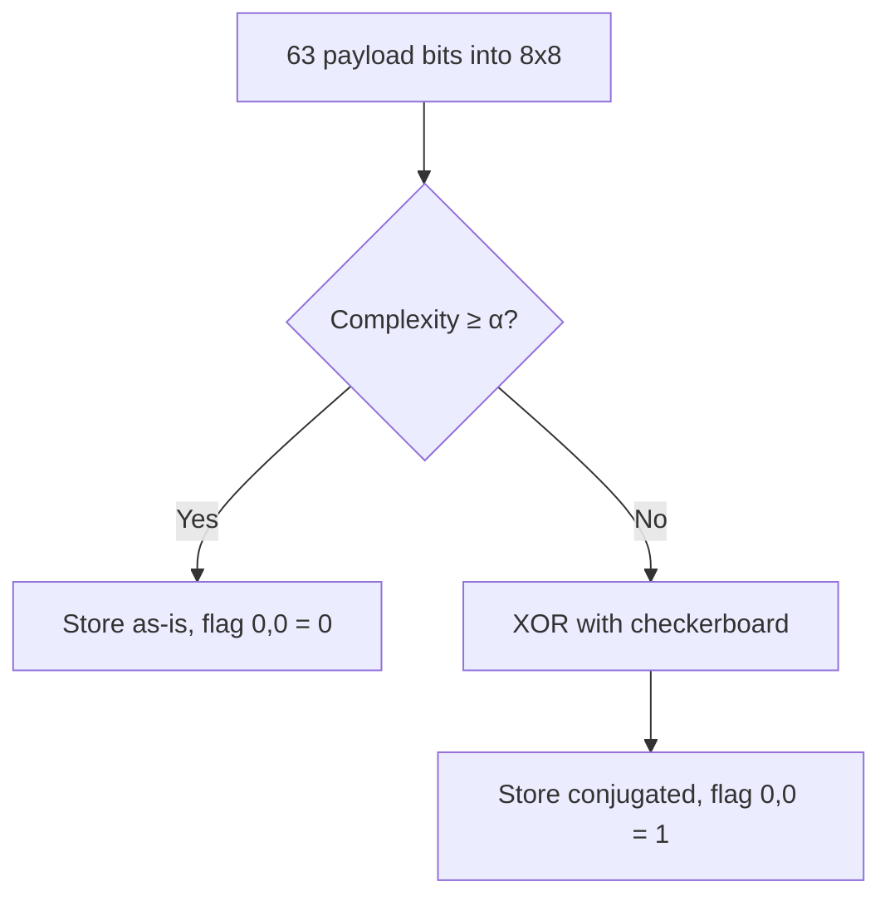
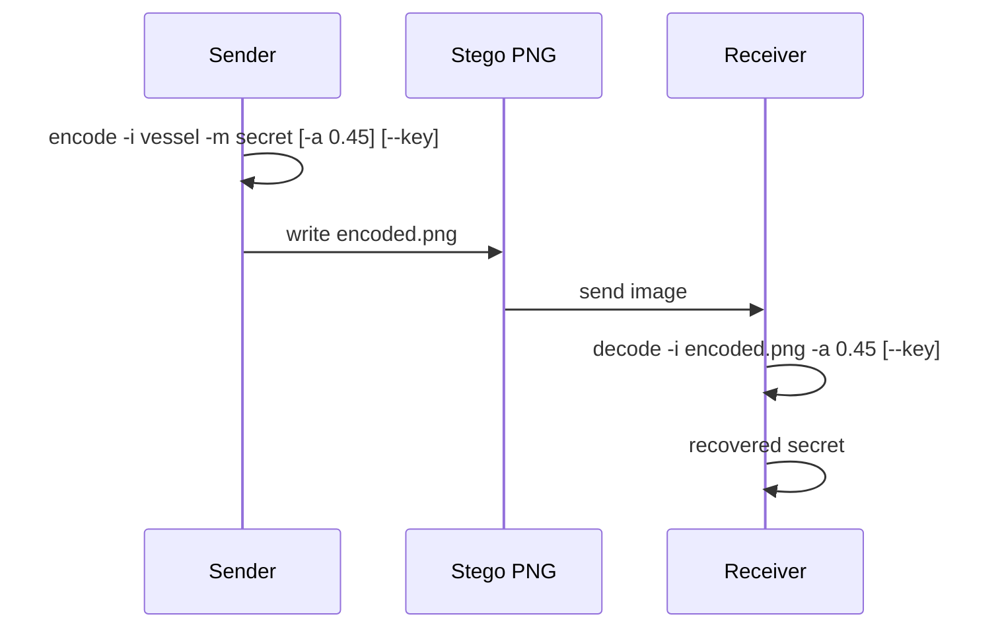

# BPCS Steganography

A picture can carry a secret.

Not in a lock on the file, and not in text nobody can read , **inside the pixels**. This tool hides a message or any file in the noisy corners of an image. You still see a normal photo. Someone scrolling past should not notice anything was added.

That is the idea of **BPCS** (Bit-Plane Complexity Segmentation): busy, speckled patches in an image already look like static to the eye. The program slips your data into those patches and leaves the smooth, meaningful parts alone.

If you used a password, the hidden file is encrypted first. To open it, the other person needs this program, the same setting (`-a 0.45`), and that password.

One limit: treat the picture gently. Save it as **PNG**. If it gets compressed as JPEG or heavily edited, the secret can vanish.

---

## Features

- **Hide data in busy parts of the image**: the tool looks at tiny 8×8 patches and only changes the ones that already look like noise.
- **Gray-code bit planes**: it rearranges pixel bits (CGC) so hiding data is less likely to add ugly edges.
- **Conjugation**: if a piece of secret data is too “simple,” it is flipped with a checkerboard so it looks noisy enough to hide.
- **Optional password**: you can encrypt the secret with AES-256 before hiding it.
- **Checks on extract**: a short `BPCS` header helps confirm that a real payload was found.

---

## Encode and decode pipeline



---

## Conjugation

If a packed 8×8 piece of secret data is too simple, it is mixed with a checkerboard. The top-left bit `(0, 0)` remembers whether that mixing was used.



---

## Sender and receiver



---

## Technical Overview

1. **Bit-Plane Decomposition**: Converts RGB pixels into 24 CGC bit-planes (8 per channel).
2. **Complexity Assessment**: Measures noise in each 8×8 block as K = (h + v) / 112 (default threshold α = 0.45).
3. **Conjugation**: If a payload block’s complexity is below α, it is XORed with a checkerboard and bit `(0, 0)` stores the conjugation flag.
4. **Embedding**: Replaces noise-like (high-complexity) blocks in the vessel image with payload bits.

---

## Setup

```bash
python3 -m venv .venv
source .venv/bin/activate
pip install -r requirements.txt
```

---

## Usage

Encode:

```bash
python bpcs.py encode -i files/vessel.png -m files/message.txt -o stegg/encoded.png
```

Decode (use the same `-a` value):

```bash
python bpcs.py decode -i stegg/encoded.png -a 0.45 -o stegg/message_decoded.txt
```

Optional AES key:

```bash
python bpcs.py encode -i files/vessel.png -m files/message.txt -o stegg/encoded.png --key "shared-secret"
python bpcs.py decode -i stegg/encoded.png -o stegg/message_decoded.txt --key "shared-secret"
```

Other commands:

```bash
python bpcs.py capacity -i files/vessel.png -a 0.45
python tests/test_roundtrip.py
```

Use lossless PNG. JPEG or other lossy processing will destroy the hidden data.
